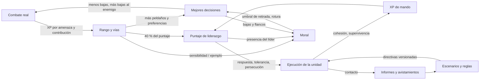

# VISION_ARQUITECTURA — cómo encaja todo (2026-10-09)

Documento de visión para David y para cualquier sesión de Claude Code que necesite el cuadro completo antes de tocar un sistema. Describe **qué es cada pieza, qué lee, qué escribe, a qué ritmo, cómo se conecta con las demás y qué profundidad tiene hoy y tendrá después**. Distingue tres estados: **[real]** (existe en el código de E3A, compilado; ojo: no probado en juego y con los fallos de `REVISION_E3A.md`), **[diseño firme]** (documentado, entra en E3B) y **[idea]** (futuro). Si algo de aquí contradice `ARQUITECTURA_VETERANIA.md` o `DECISIONES_DAVID_2026-10-08.md`, mandan esos.

---

## 1. La idea en una página

**Rally of the Guard es un ejército que piensa, no un ejército que pega más fuerte.** Todo lo que hace profundo al mod cabe en una frase: *cada guardia, cada capitán y cada plan toman mejores decisiones cuanto más experiencia, mejor mando y mejor información tienen, y las toman con peor criterio cuando están asustados, desorganizados o sin líder.* Nada de eso se compra con vida, daño ni velocidad.

De ahí salen cuatro ideas que sostienen el diseño:

1. **Las estadísticas son iguales; las decisiones no.** Un guardia de rango 0 y uno de rango 5 con el mismo equipo tienen la misma vida, el mismo daño y la misma velocidad. El de rango 5 elige mejor *dónde* está, *a quién* ataca, *cuándo* se retira y *cuánto* aguanta la formación. (Excepción reconocida y pendiente de tu decisión: alcance y puntería por rango; ver `REVISION_E3A.md` §C.)
2. **Mando de misión.** El jugador (o el Battle Planner) dice **qué** y **por qué** (objetivo, restricciones, disparadores); los capitanes y generales deciden **cómo**, y los guardias deciden **el detalle**. Cada nivel solo compila órdenes para el de abajo y nunca lo salta. Cuando falta un nivel, el de abajo sigue con su mejor criterio (degradación elegante, §7).
3. **Información explícita.** Nadie "sabe" lo que no ha visto: las unidades publican informes (solo cuando cambian), los generales los resumen en avistamientos con caducidad, y el planner y los escenarios reaccionan a esa información. Es la base de emboscadas, de la niebla de guerra y de los exploradores futuros.
4. **Todo es barato por diseño.** Eventos en vez de escaneos, 1 Hz escalonado en vez de por tick, cachés invalidadas por eventos, presupuesto medido por `Perf`. El objetivo es 200 guardias sin que Rally pase de ~0,5 ms/tick; hoy mide 0,26 ms/tick con 200.

**Lo que no es:** un RTS de microgestión (no hay clics por unidad en combate), un juego de estadísticas (no hay "nivel 50 pega ×3"), ni un sistema de scripts rígidos (los planes dan intención y restricciones, no coreografías).

---

## 2. El mapa de capas

```
 JUGADOR ──(pergamino sobre mesa en el HQ / Libro de Mando / teclas G·H·J)
    │ intención: objetivo + doctrina + fases + vínculos + escenarios        [real v1 / diseño v2]
    ▼
 PLAN ───────────────  Battle Planner: PlanRegistry, fases, vínculos, plantillas, escenarios
    │ reglas con prioridad + histéresis, operaciones (mantener, retroceder atacando, flanqueo…)
    ▼
 FUERZA ─────────────  general = mejor Puntaje de liderazgo entre los capitanes
    │ roles (yunque, martillo, pantalla, apoyo, flanco, reserva) + ForceBrain (≤1 Hz por fuerza)
    ▼  una directiva VERSIONADA por unidad (UnitOrders), no una orden por guardia
 UNIDAD ─────────────  capitán = mejor Puntaje de liderazgo de la unidad
    │ formación (forma + densidad + sobrecarga + carriles), estilo de fuego, ritmo, intérprete de instrucción
    ▼  cada guardia aplica la versión más nueva en su turno de 1 s (SlotQueue reparte huecos)
 GUARDIA ────────────  escalera de decisión (rangos 0–4) o núcleo de 10 pasos (rango 5)
                       lee: directiva, imagen del escuadrón, terreno, moral, memoria de amenazas
                       escribe: objetivo, posición, arma, estilo de fuego, retirada
```

**Corrientes transversales** (cruzan todas las capas; son lo que da profundidad):

| Corriente | Qué es | Quién la produce | Quién la consume |
|---|---|---|---|
| **Veteranía** | rango 0–5, rasgos, vías tras el 5, maestría, historia | combate real | escalera/núcleo, liderazgo, moral, valoración |
| **Liderazgo** | Puntaje 0–100 y calidad de ejecución | rango, rasgo, XP de mando, experiencia de unidad, vía de mando | elección de capitán y general, retraso de respuesta, tolerancia de formación, persecución, relevo |
| **Moral y cohesión** [diseño] | ánimo por guardia, unión por unidad | bajas, flanqueo, inferioridad, presencia de líder, descanso | decisión (umbral de retirada, evitar enganche, negarse a atacar), reglas de fuerza, informes |
| **Perfil de grupo** [diseño] | composición, consistencia, identidad, capacidades | equipo y montura reales | intérprete de instrucciones, planner (vínculos por capacidad), calidad de ejecución |
| **Información** [real] | `SituationReport`, `KnownEnemy` (60 s) | unidades (solo al cambiar) | fuerza, reglas, escenarios, UI del planner |
| **Terreno** [real] | `TerrainSense` (≤ 8 candidatas, 1 Hz, caché) | mundo | decisión de rangos ≥ 2, emboscadas, planner |
| **Doctrina** [real] | pesos de la escalera (7 doctrinas) | jugador/plan/fuerza | decisión del guardia |

---

## 3. Los sistemas, uno por uno

Cada ficha: qué hace · qué lee · qué escribe · cuándo corre · estado · profundidad objetivo.

### 3.1 Veteranía (el centro de profundidad)
- **Qué hace:** convierte combate real en rango (0–5) y, después del 5, en cinco vías (maestría de arma, supervivencia, mando, vínculo con la montura, historia). Los rasgos (7) se eligen por rango a partir de historia y afinidad (genética MCA si existe) y son **preferencias de decisión**, no bonos.
- **Lee:** daño causado y recibido con tope por el HP real de la víctima (sin XP por sobrante), `Threat` del enemigo, contribución (daño, asistencias, cubrir a un compañero), superioridad numérica en contra, supervivencia cerca de la muerte, tiempo de pelea. **Escribe:** `VeterancyRegistry` (por UUID): XP, rango, vías, rasgos, tipos vistos, relato.
- **Corre:** por evento (daño, muerte, fin de pelea); topes por minuto; rendimientos decrecientes por tipo repetido.
- **Qué desbloquea [real]:** peldaños de la escalera por rango (formación bajo presión desde 2, prioridad de objetivos desde 3, cambio de arma y fuego y movimiento desde 4, núcleo de 10 pasos en 5), alcance y puntería, maestría de arma (`MasteryEffects`), peso en el Puntaje de liderazgo.
- **Estado y honestidad:** el diseño es sólido y el XP ya se concede por amenaza y contribución, pero **hoy buena parte de lo que desbloquean los rangos 3–5 está apagado por el desbordamiento de `SquadPicture` (A1 de `REVISION_E3A.md`)**. Es lo primero que corrige el Bloque R.
- **Profundidad objetivo (escala L0–L5, §6):** hoy L2; E3B la lleva a L4 (vías con efectos reales, memoria de amenazas, historia/valoración, ejemplo sobre la moral).

### 3.2 Liderazgo (capitanes y generales)
- **Qué hace:** decide **quién manda** y **cómo de bien se ejecuta lo mandado**. No da números de combate.
- **Puntaje (0–100) [real]:** pesos por defecto 40 rango + 15 rasgo LEADER + 20 XP de mando (1 − e^(−XP/300)) + 15 experiencia de la unidad (rango medio) + 10 vía de mando. Recalculado **solo por eventos** (`Leadership.invalidate`: subir de rango, cambio de unidad, muerte, relevo) y cacheado por época.
- **Selección:** **capitán** = mejor puntaje de su unidad (desempate por UUID, total); **general** = mejor puntaje entre los capitanes de la fuerza. Nada se nombra a mano, ninguna entidad nueva. `maxDirectSubordinates` [diseño]: si una unidad lo excede, se crea una subunidad con el mejor puntaje restante, así escala a cientos sin un solo capitán mandando a 200.
- **Efecto [real]:** `quality = puntaje/100` del líder de la directiva modula, con multiplicadores acotados: **retraso de respuesta** a una directiva (0–40 ticks), **tolerancia de formación** (×1,3 peor a ×0,7 mejor), **exceso de persecución** (×1,15 a ×0,85) y **tiempo de relevo** (0–100 ticks). Un capitán excelente no hace más fuerte a nadie: hace que la unidad **responda antes, se rompa menos, no se disperse y se reorganice rápido**.
- **Sucesión [real]:** si cae el capitán, `CaptainSuccession` elige relevo (con retraso según *su* puntaje); si la unidad pierde más capitanes de los que puede reponer en 5 minutos, se rompe (estado ROUTED; hoy inalcanzable por un fallo, A11).
- **Ampliaciones [diseño]:** *estilo de mando* derivado de rasgos e historia (Prudente, Audaz, Metódico): cambia cómo se interpreta la misma intención (§4.5); *experiencia de unidad* con decaimiento; presencia del líder como factor de moral.

### 3.3 Moral y cohesión [diseño firme, E3B]
- **Qué hace:** hace que las batallas tengan **fases**: aguantar, vacilar, romper, reagruparse. Inspirado en el modelo de Total War (presencia del general, bajas, fatiga, inferioridad, muerte del líder; estados saludable → penalizada → vacilante → rota → destrozada) y en la distinción histórica **moral (querer seguir) ≠ cohesión (seguir unidos)**.
- **Moral (por guardia, 0–100)** y **cohesión (por unidad, 0–100)**. Estados FIRME / INQUIETO / VACILANTE / ROTO / DESTROZADO con histéresis y duración mínima. Factores a la baja: bajas (no lineal, fuerte entre 10 % y 30 %), muerte de compañeros cercanos (más el capitán), inferioridad local, golpes por la espalda o el flanco, fatiga, aislamiento, amenaza fuera de escala (`Threat`), falta de líder, contagio acotado. A la alza: presencia del líder (∝ Puntaje), estandarte/HQ, rango y rasgos, momentum, refuerzos, terreno, formación íntegra, descanso en HQ ("Relajados").
- **Efecto:** solo preferencias de decisión: sube el umbral de retirada, evita cargar, se niega a atacar sin huir (cohesionado pero sin fe), huye al capitán o al HQ por la ruta segura, se reagrupa con el líder a la vista. **Nunca** vida, daño ni velocidad. Interruptor y fuerza (`morale.enabled`, `morale.strength` por defecto 0,6).
- **Conexión central con la veteranía:** sensibilidad por rango (1,00 / 0,90 / 0,80 / 0,68 / 0,55 / 0,45) y "ejemplo" de rangos 4–5 sobre sus vecinos (acotado a +10). Por eso un legendario cambia el ánimo de su unidad sin dar números de combate.

### 3.4 Perfil de grupo e intérprete de instrucciones [diseño firme, E3B]
- **Perfil:** composición por arquetipos (infantería de línea/pesada, lanceros, arqueros, ballesteros, tiradores, caballería ligera/pesada/**de rango**…), atributos agregados, **puntuación de consistencia 0–100** (entropía de firmas arquetipo+montura), **identidad** ("Caballería de rango") y **avisos**. Es la **única fuente de las capacidades** (`Capability`) y se muestra como tarjeta pequeña en el planner.
- **Intérprete:** `resolve(instrucción, perfil) → Behavior` (doctrina, estilo de fuego, forma, densidad, banda de distancia, reglas de enganche, disparador de retirada, ritmo). La misma "Hostigar" es volea a alcance máximo para arqueros, kiting para caballería de rango, rodear con escudo y lanza para infantería pesada, golpe y fuga para caballería pesada. Tabla en `config/rallyguard-instructions.json`; una instrucción nueva = una fila.
- **Consistencia → ejecución:** un grupo incoherente ejecuta peor las órdenes de especialidad (tope ±15 % sobre `Leadership.quality`). El sistema **refleja** el desorden, no lo prohíbe.

### 3.5 Battle Planner (Plan → Fuerza)
- **[real, E3A] v1:** mapa cenital cacheado por lotes, fichas de unidad, doctrina, papeles, fases con disparadores (TIME, CASUALTIES, ENEMY_SEEN, CONTACT), 8 vínculos (relevo, cobertura, refuerzo, enlace, pantalla, escolta, mantener hasta relevo, retirada escalonada), plantillas, guardar/cargar planes, autoridad en el servidor, ítem = pliego sobre una mesa dentro de un HQ.
- **[diseño firme, E3B] v2:** (P1) relleno de huecos por importancia, emboscadas con información compartida, carriles abiertos, cambios de ritmo, contragolpe, ganar tiempo, infantería de primera clase; (P2) **escenarios** detectados y respondidos (emboscada enemiga, asalto/defensa de estructura, oleada, amenaza aérea, jefe, enemigo en fuga, batalla perdida, inferioridad, capitán caído); (P3) interfaz de mesa de batalla.
- **Contrato:** el planner **no** manda a guardias; escribe reglas, operaciones y directivas versionadas por unidad. Es lo que hace que escale (§8).

### 3.6 Información: informes y avistamientos [real]
`SituationReport` por unidad (vivos/total, vida, munición, enemigos vistos, contacto, centro, centro enemigo), publicado **solo al cambiar significativamente**; `KnownEnemy` por fuerza (centro, recuento, instante; caduca a 60 s). Hoy hay dos fallos que se corrigen en R (bajas como marca de agua máxima, centros obsoletos). En E3B se amplía con moral, cohesión, composición enemiga (melé/rango/volador/jefe) y rotos. **Es el cable que conecta unidades entre sí** (emboscada: B ataca donde A informa que está el enemigo, sin verlo).

### 3.7 Terreno, doctrina, orden del jugador
- `TerrainSense`: etiquetas de cobertura, altura, defendible, agua, bosque, estrechamiento (≤ 8 candidatas, 1 Hz). Alimenta rangos ≥ 2, y en E3B la ocultación de emboscadas.
- `Doctrine`: 7 pesos sobre la escalera (STANDARD, HARASS, AVOID_CASUALTIES, DISTRACT, ALL_OUT, HOLD_POSITION, AMBUSH). Una doctrina no es un código nuevo; es una forma de pesar lo mismo.
- **Precedencia (de mayor a menor):** Mantener fuego (H) → orden explícita del jugador (60 s) → directiva automática más nueva de la unidad → reglas de fuerza por prioridad → escalera del guardia (resuelve el "cómo" sin cambiar modo ni puesto). Detalle en `ORDENES_JERARQUIA.md`.

---

## 4. Cómo se conectan: la matriz de influencias

Lectura: **fila → columna** = "lo que la fila le da a la columna". Cada celda indica **el dato**, **el efecto** y **el límite** (que evita que un sistema domine o rompa a otro).

| De ↓ / A → | Decisión del guardia | Liderazgo / ejecución | Moral y cohesión | Perfil / intérprete | Planner / fuerza |
|---|---|---|---|---|---|
| **Veteranía** | Rango desbloquea peldaños (2 formación, 3 prioridad/foco, 4 arma y movimiento, 5 núcleo); rasgos = pesos. *Límite:* sin stats de daño/vida/velocidad. | 40 % del puntaje + vía de mando + XP de mando. *Límite:* puntaje 0–100, multiplicadores acotados. | Sensibilidad por rango, ejemplo de rangos 4–5. *Límite:* +10 máx. a vecinos. | Rango medio y dispersión en el perfil. | Rango en tarjetas y fichas; valoración (informativa). |
| **Liderazgo** | Retraso de respuesta, tolerancia de formación, persecución (vía `quality`). | — (se autoalimenta por XP de mando). | Presencia del líder en radio sube moral; su caída la baja; rapidez de reagrupar. | Estilo de mando [idea] pesa la interpretación. | General = mejor capitán; capitán = mejor de su unidad. |
| **Moral / cohesión** | Umbral de retirada, evitar enganche, negarse a atacar, huir/reagrupar. *Límite:* `morale.strength`, histéresis. | Cohesión baja ⇒ calidad de ejecución baja. | — (contagio acotado). | Cohesión baja si el perfil es heterogéneo. | Informes con moral/cohesión/rotos ⇒ disparan relevos, refuerzos, retiradas y escenarios. |
| **Perfil de grupo** | Identidad ⇒ doctrina y estilo por defecto del subgrupo. | Consistencia ⇒ ±15 % de calidad de ejecución. | Consistencia ⇒ cohesión. | — | Capacidades (única fuente) ⇒ qué vínculos y escenarios son posibles; avisos "faltan capacidades". |
| **Planner / fuerza** | Directivas versionadas por unidad (`UnitOrders`), nunca por guardia. | Elige el capitán/general ya calculado; no los nombra. | Escenario `BATALLA_PERDIDA`, `DELAY`, retirada escalonada modulan el riesgo. | Instrucciones generales ⇒ el intérprete. | Reglas con prioridad e histéresis; operaciones; fases; escenarios. |
| **Información** | Imagen del escuadrón (enemigos, aliados, prioridad, foco). | Informe ⇒ XP de mando al cerrar la pelea. | Inferioridad local, flanqueo detectado. | — | `KnownEnemy` ⇒ emboscadas, contragolpe, escenarios. |
| **Terreno** | Cobertura/altura/posición antes de atacar (rango ≥ 2; núcleo de 5). | — | Terreno ventajoso sube moral. | — | Punto de espera oculto de emboscada. |

**Tres propiedades que esta matriz garantiza:**
1. **Una sola vía por cada efecto.** Si algo afecta a la ejecución, pasa por `Leadership.quality`; si afecta a "cuánto quiere pelear", pasa por la moral; si afecta a "qué puede hacer el grupo", pasa por el perfil. No hay cinco sitios donde ajustar lo mismo.
2. **Ningún sistema escribe en el nivel de otro.** El planner no mueve guardias; la moral no cambia directivas (solo cambia cómo las ejecuta el guardia); el liderazgo no elige objetivos.
3. **Todo número que entra a un multiplicador está acotado y es configurable**, y la simulación comprueba que vida/daño/velocidad no cambian.

### 4.5 Intención, no coreografía (por qué los planes dan "qué" y "por qué")
Un plan contiene **objetivo**, **restricciones** (no pasar de aquí, mantener la retirada abierta, no cruzar el agua), **disparadores** y **vínculos**. No dice "el guardia 14 va a la coordenada X". El capitán interpreta esa intención con el perfil de su unidad (§3.4) y, en E3B+, con su **estilo de mando** (Prudente prefiere ceder terreno antes que bajas; Audaz acepta riesgo por tiempo; Metódico reparte el relevo con más margen). Dos capitanes con el mismo plan producen batallas distintas: ahí vive la rejugabilidad y la razón por la que el jugador quiere a *ese* capitán concreto.

---

## 5. Los bucles de retroalimentación (donde está la profundidad… y los peligros)



1. **Bucle de excelencia (positivo, el motor de la progresión).** Combate → XP → rango → mejores decisiones → menos bajas y más victorias → más XP. *Peligro: "el rico se hace más rico"* (los veteranos acaparan XP y los reclutas nunca suben). *Frenos ya diseñados:* XP por **valor de amenaza** limitado por el HP real de la víctima, reparto por **contribución** (cubrir a un compañero cuenta), bonificación por **inferioridad numérica**, topes por minuto, decaimiento por tipo repetido, sin XP por golpear a un inmóvil. *Medida:* distribución de rangos tras N horas de juego simulado (¿hay recién llegados que alcanzan R2?).
2. **Bucle de mando (positivo, más lento).** Buen capitán → unidad cohesionada y viva → XP de mando → mejor puntaje. *Peligro:* un capitán insustituible (si cae, todo se rompe). *Frenos:* sucesión con retraso proporcional al puntaje del relevo, `maxDirectSubordinates`, la experiencia de unidad pesa solo el 15 %, y la **degradación elegante** (§7).
3. **Bucle de moral (negativo y positivo).** Bajas ↓ moral → prudencia → menos bajas (**estabilizador**). Pero el **contagio** (un vecino huye → baja la moral → huyen más) es positivo y puede convertir una derrota local en un colapso. *Frenos:* contagio con rendimientos decrecientes y tope, presencia del líder como contrapeso, histéresis y duración mínima entre estados, `morale.strength`, estado DESTROZADO acotado a "sin capitán y > 50 % de bajas". *Alarma automática:* más del 20 % ROTOS en una pelea pareja de rango ≥ 3 con capitán = "moral demasiado sensible".
4. **Bucle de información (el cable del planner).** Informes → avistamientos → reglas y escenarios → directivas → contacto → informes. *Peligros:* **informes obsoletos** (hoy ocurre, R3), oscilación (regla ↔ regla) y conflicto plan ↔ regla. *Frenos:* eventos por cambio significativo, histéresis por regla, prioridad por regla, restauración de la operación anterior al terminar una regla (R4).
5. **Bucle de apego (el pegamento emocional).** Historia, relato y valoración hacen que el jugador reconozca a *sus* guardias; el "por qué decidió" los hace legibles. Es lo que convierte un sistema en una experiencia: sin esto la profundidad es invisible.

---

## 6. La escala de profundidad (qué significa "más profundo")

Para no discutir en abstracto, cada sistema se mide en una escala común:

| Nivel | Significado | Ejemplo (veteranía) |
|---|---|---|
| **L0** | Contadores o etiquetas sin efecto. | "Kills: 14". |
| **L1** | Un efecto directo y visible. | El rango abre peldaños de la escalera. |
| **L2** | Varias entradas ponderadas, con topes y anti-abuso. | XP por amenaza y contribución; rasgos como preferencias. |
| **L3** | Se conecta con otro sistema y cambia **su** comportamiento. | Vías tras el 5 con efectos; memoria de amenazas; el rango da liderazgo. |
| **L4** | Bucle cerrado medido en simulación, con alarmas. | Sensibilidad de moral por rango, ejemplo sobre vecinos, métricas `ceiling-*`. |
| **L5** | Comportamiento emergente observable y legible para el jugador. | Una unidad curtida que "aprende" a mantener la línea; estilos de mando distintos en el mismo plan. |

| Sistema | Hoy [real, con fallos] | Tras E3B (+R) | Siguiente salto |
|---|---|---|---|
| **Veteranía** | **L2** (L3 en papel, pero buena parte apagada por A1) | **L4** | L5: cultura de unidad, tradiciones, valoración de mercado |
| **Liderazgo / capitanes** | **L2** (puntaje, calidad, sucesión) | **L3–L4** (cohesión, ejemplo, relevo coherente) | L5: estilos de mando, estado mayor, superintendente |
| **Moral / cohesión** | **L0** (solo `ROUTED` en sucesión) | **L3–L4** | L5: pánico por tipo de enemigo, reputación de unidad |
| **Perfil de grupo / instrucciones** | **L1** (capacidades derivadas a mano) | **L3** | L4: aprendizaje de interpretaciones favoritas por capitán |
| **Battle Planner** | **L2** (fases, vínculos, mapa) | **L3** (relleno, emboscadas, escenarios, mesa) | L4: laboratorio de improvisación promueve tácticas; campañas |
| **Información** | **L1–L2** (con fallos) | **L3** | L4: exploradores y niebla real; retraso por mensajeros |
| **Terreno** | **L2** | **L3** (ocultación) | L4: ingenieros que lo modifican |

**Criterio de promoción de nivel:** un sistema sube de nivel solo cuando (a) tiene su escenario de simulación, (b) su alarma de desequilibrio no salta y (c) `/rally debug why` explica sus decisiones. Sin eso, "implementado" no cuenta como "profundo".

---

## 7. Los roles de mando, con precisión

Cuatro roles **calculados** (nadie es una entidad nueva) más uno futuro. Cada uno responde a: ¿cómo se obtiene? ¿qué ve? ¿qué puede mandar? ¿qué le está prohibido? ¿qué pasa si cae o falta?

| Rol | Cómo se obtiene | Qué ve | Qué puede hacer | Qué NO puede | Si cae o falta |
|---|---|---|---|---|---|
| **Guardia** | es el guardia | su directiva, la imagen del escuadrón, terreno, su moral, memoria de amenazas | decidir objetivo, posición, arma, estilo de fuego, retirada; salvarse (excepción del peldaño 1) | cambiar su modo o su puesto por iniciativa | — (si no hay directiva sigue su doctrina y su escalera) |
| **Capitán** (unidad) | mejor Puntaje de liderazgo de su unidad (desempate por UUID) | informes de sus miembros, su moral y cohesión, avistamientos que le llegan | traducir la directiva de la fuerza a **formación** (forma, densidad, sobrecarga, carriles), **estilo de fuego**, **ritmo**; repartir huecos (`SlotQueue`); reagrupar rotos; publicar el informe | dar daño/vida/velocidad; mandar a más de `maxDirectSubordinates` (se crea subunidad) | **Relevo** del siguiente mejor puntaje con retraso ∝ su puntaje; la unidad conserva la última directiva; moral ↓ por falta de líder; si caen más capitanes de los que repone en 5 min → ROTA |
| **General** (fuerza) | mejor puntaje entre los capitanes de la fuerza | informes de todas las unidades y `KnownEnemy` | proponer **roles** (yunque, martillo, pantalla, apoyo, flanco, reserva), compilar reglas a directivas por unidad, iniciar **operaciones**, ejecutar fases del plan, elegir sustituto de un hueco | mandar a guardias sueltos; saltarse la unidad | Pasa a general el siguiente capitán; roles congelados hasta el relevo; el plan sigue con retraso y la moral de las unidades baja ligeramente |
| **Planificador** (jugador + mesa) | el jugador, dentro de un HQ | mapa, fichas, tarjetas de grupo, escenarios | plan completo: objetivo, doctrina, fases, vínculos, importancia, escenarios; orden explícita individual (gana 60 s) | tocar la ejecución tick a tick | Sin jugador conectado la fuerza sigue con el último plan y sus escenarios; sin plan, con su doctrina y reglas por defecto |
| **Superintendente** [idea, E3C+] | rol logístico por perfil | inventarios, HQ, municiones | reabastecer, preparar equipo, relevos de material | — | la logística vuelve a ser manual |

**Presencia de mando (nuevo, propuesta):** el líder cuenta como "presente" para la moral dentro de un radio (capitán 16 bloques, general 32; configurables). Dentro, la moral de los suyos sube en proporción a su puntaje; al caer, hay un golpe puntual de moral (mayor si era el general). Es el equivalente a la presencia del general en Total War, adaptado a la escala de Minecraft.

**Degradación elegante (regla general):** *quien manda falta ⇒ el nivel de abajo sigue con su mejor criterio, nunca se queda quieto.* Sin capitán, cada guardia sigue su escalera con la última directiva y la doctrina de su unidad; sin general, los capitanes actúan sobre la última directiva; sin plan, rige la doctrina de la fuerza. La **calidad baja** (respuesta más lenta, formación menos tolerante, más persecución, moral más débil) pero **nada se detiene**. Esto es lo que hace que perder un líder sea un drama y no un fallo del juego.

**Qué hace que un capitán sea "bueno" (y se note):**
1. *Responde antes* (retraso de directiva hasta 40 ticks menos).
2. *Mantiene la formación* (tolerancia ×0,7 frente a ×1,3 de un mal líder).
3. *Persigue menos* (leash ×0,85 frente a ×1,15).
4. *Se reorganiza rápido* tras bajas o relevo (hasta 100 ticks menos).
5. *Sostiene la moral* de su unidad en un radio y acelera el reagrupar.
6. *[E3B]* Su estilo de mando interpreta la intención del plan (§4.5).
Todo visible en la ficha: puntaje, calidad, y "por qué decidió".

---

## 8. Ritmo, coste y escala

| Escala de tiempo | Qué corre | Ejemplos |
|---|---|---|
| **Evento** | se recalcula solo al ocurrir | rango sube, muere un guardia o capitán, cambia la composición, llega daño, empieza/termina una pelea → invalidan `Leadership`, `GroupProfile`, XP, moral del afectado |
| **1 Hz escalonado** | un turno por guardia/unidad/fuerza, repartido en los 20 ticks | decisión del guardia, informe de unidad, `ForceBrain` por fuerza, cohesión, detector de escenarios, reglas con histéresis |
| **Por tick** | solo lo que Minecraft ya hace | metas de navegación y ataque de Guard Villagers; `SlotQueue` reparte N huecos/tick |
| **Minuto / sesión** | topes y olvido | tope de XP por minuto, decaimiento por tipo, olvido de memoria de amenazas, `purge` de estados |
| **Guardado** | persistencia | registros por UUID (veteranía), fuerzas, planes; **operaciones activas aún no persisten** (R9) |

**Presupuesto propuesto (200 guardias, objetivo total ≤ 0,5 ms/tick de media):** decisiones 0,15 · formación y `SlotQueue` 0,10 · fuerzas, reglas y escenarios 0,05 · moral y cohesión 0,05 · informes 0,03 · resto (veteranía por eventos, perfiles, telemetría) 0,05 · reserva 0,07. **Medido hoy:** 0,262 ms/tick con 200 guardias *antes* de E3A (con la imagen de escuadrón apagada, así que no es representativo): hay que **volver a medir tras R** con `/rally debug perf`. Cualquier sistema nuevo que no declare su coste y su caché no entra.

**Cómo escala a 200–400:** la jerarquía convierte "una orden a 200 guardias" en unas pocas escrituras (una directiva por unidad) más una comparación de versión por guardia en su turno de 1 s. Los informes suben solo al cambiar. La imagen de escuadrón es **una consulta por escuadrón o por celda**, no por guardia (R8). Las subunidades limitan el alcance de mando. Los guardias fuera de la distancia de simulación de Minecraft simplemente no corren: el sistema no intenta compensarlo.

---

## 9. Una batalla de principio a fin (las conexiones en acción)

Fuerza "Vanguardia": unidad **Línea** (infantería pesada, capitán veterano R3), unidad **Arcos** (arqueros R2, 12), unidad **Jinetes** (caballería de rango R3, 8 + la capitana **Elena R5**, general de la fuerza). Plan: *defender el puente*, doctrina HOLD_POSITION, escenario `EMBOSCADA_ENEMIGA` con respuesta *contragolpe de los Jinetes*, `FILL_POLICY` (si cae la Línea la cubre Arcos y luego Jinetes), retirada escalonada si bajas > 40 %.

1. **Despliegue (Plan → Fuerza → Unidad).** El jugador abre el pergamino sobre la mesa del HQ. Las tarjetas muestran: Línea "Infantería pesada · consistencia 94", Arcos "Arqueros · 88", Jinetes "Caballería de rango · 91" y un aviso "2 guardias sin montura en Jinetes". Elena es general porque su Puntaje (rango 5 + rasgo LEADER + XP de mando) supera a los otros capitanes. El jugador ejecuta; `ForceBrain` compila **tres directivas versionadas** (una por unidad).
2. **Interpretación (Perfil → Behavior).** La Línea interpreta "mantener" como línea cerrada, escudos arriba, sobrecargada al centro; Arcos, como fila abierta tras la Línea con fuego sostenido; Jinetes, como reserva móvil oculta tras el cerro (doctrina AMBUSH, punto de espera elegido con `TerrainSense`).
3. **Contacto (Terreno → Decisión → Información).** Una oleada de esqueletos y zombis aparece por el flanco. Los arqueros R2 toman cobertura (peldaño 2); el R3 prioriza al esqueleto que más daño hace (peldaño 3) y concentra fuego; la Línea mantiene el sitio. Cada unidad publica un informe **solo porque cambió** su contacto: "enemigos 12 · contacto".
4. **Información → Escenario.** El detector de la fuerza (1 Hz) cruza el informe con `KnownEnemy`: enemigos aparecen a < N bloques por el flanco izquierdo durante la defensa ⇒ activa `EMBOSCADA_ENEMIGA`. Su respuesta por papel: yunque aguanta, martillo (Jinetes) golpea el flanco, apoyo ajusta fuego.
5. **Emboscada propia (Información compartida).** Jinetes no ven a los enemigos, pero reciben su posición por el informe de Línea. Salen por la ruta de aproximación oculta y atacan el flanco; Arcos **abren un carril** en su fila para que pasen y lo cierran después. Los Jinetes se ejecutan con calidad de **Elena** (respuesta casi inmediata, formación firme).
6. **Moral (Moral ↔ Decisión).** Un grupo de zombis revienta la Línea por el ala derecha: dos soldados caen y uno recibe golpes por la espalda. Su moral baja, sube su umbral de retirada, uno **se niega a atacar** (cohesionado pero inquieto) y mantiene posición. El capitán veterano está a 8 bloques: su presencia frena el contagio. Dos reclutas R0 lejos del capitán llegan a VACILANTE y rompen; huyen hacia el estandarte.
7. **Hueco (FILL_POLICY).** La Línea baja del umbral de bajas (histéresis 40 % entrada, 20 % salida): se abre el hueco. La cadena elige quién lo cubre: primero la reserva, luego Arcos (menor importancia que Jinetes, que están en su golpe). Arcos pasan a **línea cerrada de apoyo** (intérprete: los arqueros "mantener" se reconfiguran), y la Línea recibe refuerzos.
8. **Mando (Liderazgo).** Cae el capitán de Línea. `CaptainSuccession` elige relevo; el retraso depende **del puntaje del relevo** (un R2 modesto tarda 70 ticks). Durante ese tiempo la moral de la unidad cae un punto de golpe y la tolerancia de formación empeora; Elena (general) está a 20 bloques: su presencia (radio 32) amortigua. La unidad se reorganiza y sigue.
9. **Contragolpe y cierre.** Los enemigos se sobreextienden persiguiendo a los rotos; el disparador de `COUNTERATTACK` suelta la reserva sobre su punto más débil. Los enemigos restantes caen. Los reagrupados vuelven al estandarte. El informe de cierre alimenta el XP de mando de los capitanes (supervivencia de su unidad, formación mantenida, campo mantenido).
10. **Después (Veteranía y apego).** XP por amenaza y contribución: los arqueros que cubrieron a la Línea reciben bonificación; el recluta que sobrevivió cerca de la muerte sube su vía de supervivencia y **recuerda** qué lo hirió (memoria de amenazas). Un guardia sube a R3 y gana su rasgo de Tirador (prefiere altura). El capitán relevado suma XP de mando y su puntaje sube: la próxima vez será mejor general. El relato de cada uno gana una línea. En el planner, las fichas muestran bajas, moral y quién brilló.

Lo que demuestra este guion: **ningún sistema hizo el trabajo solo**. La veteranía decidió cómo peleó cada guardia; el liderazgo, cómo de bien se ejecutó; la moral, cuándo se quebró; el perfil, qué podía hacer cada grupo; la información, quién sabía qué; el planner, qué se esperaba. Y el jugador, que solo puso la intención, vio una batalla con fases y personajes.

---

## 10. Riesgos de diseño y cómo se contienen

| Riesgo | Cómo se manifiesta | Contención | Métrica / alarma |
|---|---|---|---|
| **Estadísticas encubiertas** | un multiplicador "de calidad" termina siendo daño o vida | todo multiplicador acotado y configurable; comprobación automática de igualdad de atributos entre rangos | `attrs-equal` en `summary.md`; alarma anti-inflado (R5 > 85 % en 1v1) |
| **Espiral de la moral** | contagio convierte una escaramuza en rotura total | contagio acotado y decreciente, presencia del líder, histéresis, `morale.strength` | % ROTOS en pelea pareja (> 20 % ⇒ alarma) |
| **"El rico se hace más rico"** | los veteranos acaparan XP | XP por amenaza y contribución, topes por minuto, bonificación por inferioridad | distribución de rangos a N horas simuladas |
| **Capitán insustituible** | caída del líder = colapso | sucesión coherente, degradación elegante, experiencia de unidad con peso bajo | bajas tras muerte del capitán vs. control |
| **Oscilaciones** (regla↔regla, peldaño↔peldaño, retirada↔cobertura) | el guardia "baila" | histéresis de entrada/salida, enfriamientos, duración mínima | **cambios de peldaño por guardia y minuto** (alarma > 8) |
| **Conflicto de órdenes** | plan, regla y jugador se pisan | precedencia fija (§3.7), fuente con prioridad, `resume` que restaura | escenario `precedence-*`, `retreat-restores-op` |
| **Informes viejos** | decisiones sobre un mundo que ya cambió | publicar siempre centros frescos; caducidad de avistamientos | edad media del informe (< 2 s) |
| **Complejidad ilegible** | el jugador no entiende por qué | `/rally debug why`, ficha con motivo y próximo desbloqueo, tarjeta de grupo, colores de moral | encuesta de pruebas (David) |
| **Explosión de parámetros** | 80 perillas imposibles de afinar | pocos pesos por sistema, tablas en JSON, simulación que compara lotes y señala diferencias significativas | `summary.md` "Qué aprendimos" |
| **Lag** | 200–400 guardias | eventos, 1 Hz escalonado, cachés por época, consulta por escuadrón/celda, presupuesto con degradación real (R8) | ms/tick en `/rally debug perf` |
| **Dependencia de otros mods** | una actualización de GV/MCA rompe algo | mixins mínimos con plugin que verifica la firma, `docs/API_MODS.md`, sin listas de ítems de otros mods | log de arranque; escenario de humo |
| **Pruebas que no prueban** | la simulación aprueba y el juego falla (ya pasó con `SquadPicture`) | cada sistema con escenario que **demuestra que se activa** (contadores de peldaño, `picture-live`), no solo que no crashea | cobertura de peldaños y razones en `summary.md` |
| **Persistencia incompleta** | tras reiniciar se pierden operaciones o seguimientos | persistir o documentar; valores por defecto para guardados viejos | prueba de reinicio |

---

## 11. Tablero de salud del diseño (las cifras que se miran en cada lote de simulación)

1. **Peldaños y razones usadas** por rango (¿se usan todos? ¿`AdvancedCore` decide en R5?). 2. **Cambios de peldaño por guardia y minuto.** 3. **Atributos iguales** entre rangos (booleano). 4. **Índice compuesto de excelencia R0→R5** (monótono) y 6 de 7 métricas mejoradas. 5. **Alarma anti-inflado** (R5 vs R0 en 1v1 ≤ 85 %). 6. **Moral:** tiempo hasta primer ROTO, % ROTOS a 60 s, tiempo de reagrupar, bajas en persecución. 7. **Liderazgo:** respuesta, cohesión y bajas con capitán alto vs. bajo. 8. **Consistencia de perfil** de composiciones conocidas (≥ 85 homogéneas, < 50 mezclas). 9. **Escenarios:** el detector se activa y la respuesta mejora el resultado frente a no tener plan. 10. **Histéresis:** autoprueba 39 %↔41 %. 11. **Edad del informe** y bajas falsas (0 en `split-no-casualties`). 12. **Perf:** ms/tick por sistema a 50/100/200/400. 13. **Ritmo de veteranía:** minutos de combate por rango. 14. **Persecución y fuego amigo.**

Regla: **un sistema sube de nivel (§6) solo si sus cifras de este tablero están en verde en tres lotes seguidos.**

---

## 12. Hoja de ruta de profundidad (propuesta; el orden lo decide David)

| Hito | Contenido | Resultado de profundidad |
|---|---|---|
| **E3A + R** (ahora) | fuerzas, liderazgo, planner v1, mastery, sim v3 + corrección de los fallos críticos | los sistemas **existentes** de verdad activos y medibles |
| **E3B** | grupos y perfiles, moral y cohesión, planner v2 (instrucciones, escenarios, mesa), veteranía L4, telemetría | veteranía L4, mando L3–L4, moral L3–L4, planner L3 |
| **Pruebas de David** | `/rally sim batch quick/v3/lab/v4` + juego | cifras reales del tablero §11; ajustar configuración |
| **E3C** | inventario y logística (6 espacios, máx. 1 mochila Sophisticated, HQ, muñeco de práctica), **superintendente v0**, correcciones de lo medido | logística como parte del mando |
| **E4** | **exploradores** (`RECON`: niebla real, avistamientos con retraso), **ingenieros** (puentes de bloques temporales y escolta), coliseo/valoración/mercado, vínculos entre guardias | información y terreno L4; economía de contratación |
| **E5** | laboratorio de improvisación que **promueve** tácticas con evidencia, estilos de mando completos, mando de campaña (varias fuerzas, líneas de suministro) | L5: comportamiento emergente legible |

---

## 13. Principios que no se rompen (versión corta)

1. **Decisiones, no estadísticas.** 2. **Un solo canal por efecto** (liderazgo → ejecución; moral → ganas; perfil → capacidades). 3. **Cada nivel solo manda al de abajo.** 4. **Degradación elegante: nada se detiene cuando falta un líder.** 5. **Información explícita: nadie sabe lo que no ha visto.** 6. **Todo acotado, configurable y medible.** 7. **Eventos antes que escaneos; 1 Hz escalonado; caché por época.** 8. **Sin botones nuevos fuera del planner.** 9. **Cada sistema demuestra que se activa, no solo que no falla.** 10. **El jugador pone la intención; el ejército, el oficio.**

---

## 14. Decisiones que necesito de David (ninguna bloquea el trabajo actual)

1. **Alcance y puntería por rango** (+15 %/rango, −60 % dispersión en el 5): ¿se queda como "puntería" con tope, o se mueve a ejecución (tiempo de apuntado) y se retira de los números? *Mi recomendación:* se queda con tope y se vigila con la alarma.
2. **Maestría de arma desde el rango 0** o con rango mínimo (p. ej. ≥ 2).
3. **Radio de presencia de mando** (capitán 16, general 32) y **fuerza de la moral** por defecto (0,6): ¿empezamos conservador (0,4) para que no sorprenda en las primeras pruebas?
4. **Estilos de mando** (Prudente/Audaz/Metódico): ¿entran en E3B como borrador o esperan a E5?
5. **¿La moral aplica también a facciones enemigas de guardias** (simulación y futuros bandos)? *Recomendación:* sí, con los mismos parámetros, para que las pruebas sean simétricas. Los mobs vanilla **no** la tienen.
6. **Orden de E3C vs. E4:** logística primero (necesaria para ingenieros y escolta) o clases primero (más vistoso).
